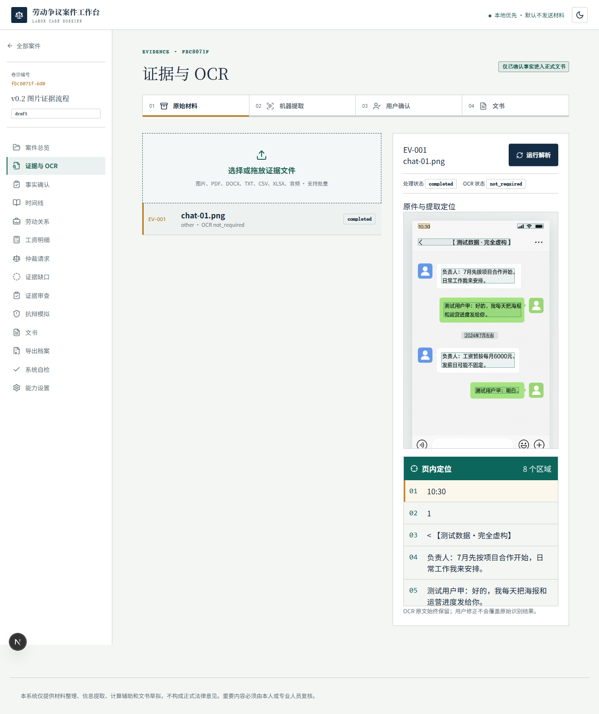

# 劳动争议案件工作台（Labor Case Agent）

**欠薪 · 劳动仲裁 · 劳动争议 · AI 证据整理 · 工资计算 · OCR · 本地 AI**

[项目介绍](https://jackeyhate9.github.io/labor-case-agent/) · [本地部署](docs/local-deployment.md) · [反馈问题](https://github.com/Jackeyhate9/labor-case-agent/issues) · [MIT 许可证](LICENSE)

Labor Case Agent is a local-first, open-source toolkit for labor disputes, unpaid wages, evidence organization, OCR, audio transcription, and draft arbitration documents. Human review is required.

本仓库提供源码与本地部署说明；GitHub Pages 为静态介绍页。安装器路径指本地构建产物，下载请以 GitHub Releases 实际附件为准。第三方依赖及可选模型遵循其各自许可证。

一个本地优先、证据可追溯的劳动争议材料整理工具。v0.2 可把聊天截图、PDF、办公文档和录音整理为可复核事实、时间线、欠薪明细、证据图谱、审查意见与仲裁文书草稿，并导出带哈希清单的完整案件档案。

> 本系统仅提供材料整理、信息提取、计算辅助和文书草拟，不构成正式法律意见。机器提取内容不会自动成为已确认事实；重要内容必须由本人或专业人员复核。



## 当前状态

- FastAPI + Next.js + Tauri v2 本地应用；`dist/LaborCaseAgent-UserSetup.exe` 为 Windows x64 用户安装器。
- Unlimited‑OCR、RapidOCR 降级路由、OCR 框/区域裁剪及图片/PDF/DOCX/XLSX/CSV/TXT 原件预览。
- MOSS Transcribe Diarize 音频转写、说话人/时间戳片段及点击片段播放；支持 WAV/MP3/M4A/MP4。
- BGE‑M3 与 Nemotron‑3‑Embed‑1B 版本化向量索引；旧案件在关闭模型时继续使用词法搜索。
- 证据图谱、证据审查 Agent、六类抗辩场景，以及可视化本地模型安装与联网 API 配置。
- 严格保持四层证据链：原始材料 → 机器提取 → 用户确认 → 文书。
- 金额使用 Decimal 确定性计算；事实、工资和文书均保留审核状态。
- ZIP 档案包含原件、OCR、已确认事实、时间线、DOCX/XLSX 草稿和 SHA-256 manifest。
- 可另行生成线下立案预填包：申请书、送达确认书、证据清单、案件要素表和办理核对清单；地方来源与适用边界会在文件内明确提示。
- 后端 111 项测试、前端 25 项测试、3 条 v0.2 真实模型 Playwright 流程与生产构建均已通过；既有覆盖率基线为 93%。

v0.2 完整结果见[最终报告](docs/v02-final-report.md)，安装说明见[Windows 发布说明](docs/windows-release.md)，边界见[已知限制](docs/known-limitations.md)。
商业化前三阶段（发布安全、数据安全、首次使用合规）的实现与正式签名构建要求见
[商业化 V1 前三阶段交付说明](docs/commercial-v1-phases-1-3.md)。

## Windows 快速启动

本项目明确提供两种运行方式：

- **5090 本地路演版**：双击 `start-roadshow-5090.bat`。它复用本机 Ollama、
  `dist/models` 和 `.venv-moss`，使用独立的路演数据目录，不修改个人安装版配置。
- **个人安装版**：向用户分发 `dist/LaborCaseAgent-UserSetup.exe`。安装器不包含
  大模型；用户打开后可连接自己的 Ollama/OpenAI 兼容 API，并在“能力设置”里按需
  下载 BGE-M3、MOSS 等可选模型。

通用启动入口 `start-labor-case-agent.bat` 仍然保留；两个版本的完整边界见
[版本说明](docs/editions.md)。

如需以源码开发模式启动，则要求 Python 3.11+、Node.js 22+。在仓库根目录执行：

```powershell
python -m venv .venv
.\.venv\Scripts\python -m pip install -e "apps/api[test,ocr]"
Set-Location apps\web
npm install
Set-Location ..\..
Copy-Item .env.example .env
.\.venv\Scripts\python -m alembic -c apps/api/alembic.ini upgrade head
.\.venv\Scripts\python -m uvicorn app.main:app --app-dir apps/api --port 8000
```

另开一个终端：

```powershell
Set-Location apps\web
npm run dev
```

打开 `http://localhost:3000`，API 文档位于 `http://localhost:8000/docs`。默认使用 SQLite；`docker-compose.yml` 提供可选 PostgreSQL 16 基础服务。

## 验证

```powershell
python -m pytest apps/api/tests -q
Set-Location apps\web
npm test -- --run
npm run build
npx playwright test --config=playwright.integration.config.ts
```

启动 API 后可访问 `GET /api/system/self-check`，它会检查数据库/表结构、私有存储、临时目录、OCR、导出依赖、法律元数据、演示样本、API 契约和日志安全。

## 演示材料与产物

- `samples/demo-case/`：完全虚构的聊天截图、银行流水、社保 PDF、工作记录 DOCX 和预期结果。
- 案件档案由应用本地导出；公开仓库不分发生成的案件压缩包。
- `docs/demo-script-3min.md`、`docs/demo-script-5min.md`：3/5 分钟演示脚本。

演示样本中的姓名、公司、金额、聊天和交易均为测试数据，不对应真实个人或单位。

## 目录

```text
apps/api/                 FastAPI、SQLAlchemy、Alembic、解析与导出
apps/web/                 Next.js 工作台、Vitest、Playwright
knowledge/metadata/       经人工核验的法源元数据目录
samples/demo-case/        虚构验收材料
artifacts/demo-case/      实际生成的演示档案
docs/                     PRD、架构、数据模型、安全、部署与验收文档
```

## 设计原则

1. 原件不可被 OCR 文本覆盖，原文件以私有案件目录保存并在导出 manifest 中记录哈希。
2. 机器提取默认是 `unreviewed`/`machine_extracted`；只有 `user_confirmed` 事实可进入正式草稿。
3. 每条事实保留来源证据、页码、原文片段、机器置信度和用户修订值。
4. 缺口分析与抗辩模拟只指出可能性，不虚构对方材料，不把推断冒充证据。
5. LLM 和 embedding 默认关闭；核心建案、OCR、计算、文书与导出不依赖云服务。
6. 大型模型不嵌入 EXE；只有用户查看体积、硬件和许可证并明确同意后才下载。API 密钥在 Windows 使用当前用户级 DPAPI 加密，页面和日志不回显。

## 文档入口

- [产品需求](docs/product-requirements.md)
- [系统架构](docs/system-architecture.md) / [数据模型](docs/data-model.md) / [API 参考](docs/api-reference.md)
- [法律安全边界](docs/legal-safety-boundaries.md) / [隐私与安全](docs/privacy-and-security.md) / [威胁模型](docs/threat-model.md)
- [本地部署](docs/local-deployment.md) / [OCR Provider](docs/ocr-provider.md) / [Ollama 设置](docs/ollama-setup.md)
- [5090 路演版与个人安装版](docs/editions.md)
- [参考仓库审计](docs/reference-repository-audit.md) / [许可与归属](docs/license-and-attribution.md)

## 支持项目

如果项目对你有帮助，欢迎自愿赞助，支持后续维护。赞助不影响 MIT 许可下的使用，也不代表法律服务或案件结果承诺。付款前请核对收款人。


## 第三方参考与许可

六个公开仓库仅用于只读的架构、交互和流程审计；本项目没有复制其源码。许可证与 README 声明存在冲突的仓库已单独标注，详见许可与归属文档。
# Windows desktop v0.2

Windows x64 builds use a Tauri v2 shell with a PyInstaller FastAPI sidecar and
the complete Next.js standalone workspace. The canonical artifact
`dist/LaborCaseAgent.exe` is an NSIS installer (not a portable executable).
The verified v0.2 artifact uses the `rapidocr` sidecar and performs local CPU
OCR. Large CUDA/audio/embedding runtimes and weights are not bundled. See
`docs/v02-release.md`, `docs/security-v02.md`, and `docs/unlimited-ocr.md` for
the verified scope and known limitations.
